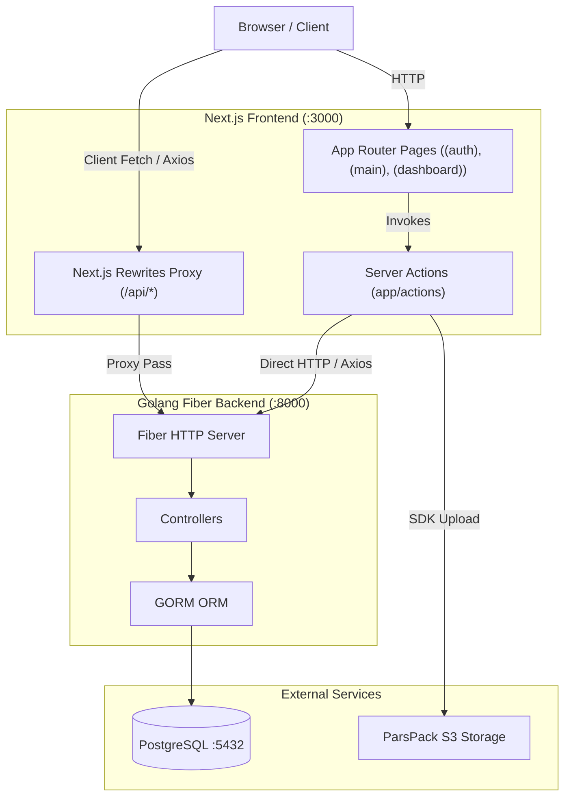
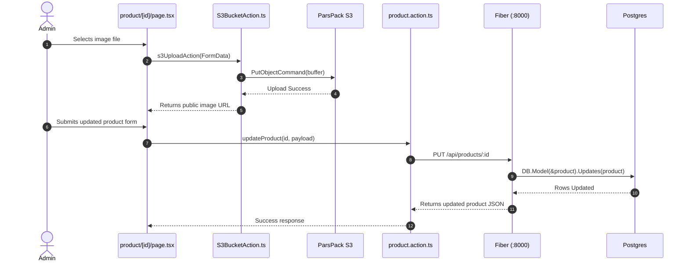
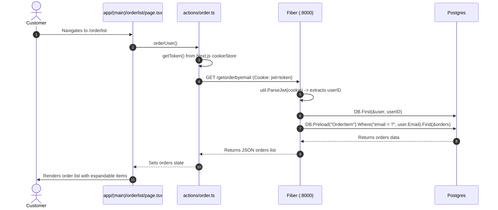
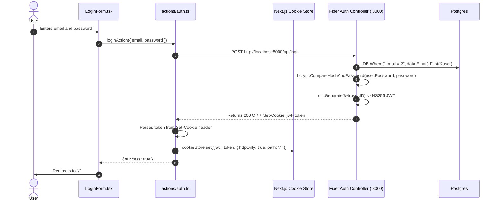

# Current Architecture Documentation

> **Document Status**: Factual architectural record as of September 2026.  
> **Constraint**: This document reflects the codebase as it actually exists today, without describing idealized, future, or proposed architectures.

---

## 1. System Overview

The application is structured as a two-tier monorepo consisting of:
* **Backend**: A REST API written in Golang using the [Fiber v2](file:///g:/react/next-go/Full-Stack-App-Store/backend/go.mod#L5) web framework and [GORM v1](file:///g:/react/next-go/Full-Stack-App-Store/backend/go.mod#L30) with PostgreSQL.
* **Frontend**: A client/server web application built with [Next.js 16 (App Router)](file:///g:/react/next-go/Full-Stack-App-Store/frontend/package.json#L28), [React 19](file:///g:/react/next-go/Full-Stack-App-Store/frontend/package.json#L32), [TypeScript 5](file:///g:/react/next-go/Full-Stack-App-Store/frontend/package.json#L56), and [Tailwind CSS v4](file:///g:/react/next-go/Full-Stack-App-Store/frontend/package.json#L53).

The repository does not contain monorepo orchestration tools (no root `package.json`, Turborepo, Nx, or Docker Compose configuration). The two tiers are run and managed independently.



---

## 2. Application Entry Points

### Backend Entry Point
* **File**: [`backend/main.go`](file:///g:/react/next-go/Full-Stack-App-Store/backend/main.go#L10)
* **Execution Flow**:
  1. Calls [`databases.Conect()`](file:///g:/react/next-go/Full-Stack-App-Store/backend/databases/conected.go#L11) to establish the database connection and trigger GORM AutoMigration.
  2. Instantiates Fiber application: `app := fiber.New()`.
  3. Registers CORS middleware with `AllowOrigins: "http://localhost:3000"` and `AllowCredentials: true`.
  4. Calls [`routes.Setup(app)`](file:///g:/react/next-go/Full-Stack-App-Store/backend/routes/routes.go#L8) to mount API routes.
  5. Listens on TCP port `:8000`.

### Frontend Entry Points
* **Root Layout**: [`frontend/app/layout.tsx`](file:///g:/react/next-go/Full-Stack-App-Store/frontend/app/layout.tsx#L18)  
  Wraps the entire application with HTML metadata, font styles, [`ThemeProvider`](file:///g:/react/next-go/Full-Stack-App-Store/frontend/components/theme-provider.tsx), Sonner [`Toaster`](file:///g:/react/next-go/Full-Stack-App-Store/frontend/app/layout.tsx#L35), and an outer [`SidebarProvider`](file:///g:/react/next-go/Full-Stack-App-Store/frontend/components/ui/sidebar.tsx) containing [`AppSidebar`](file:///g:/react/next-go/Full-Stack-App-Store/frontend/components/appSidebar.tsx).
* **Public Storefront Entry**: [`frontend/app/(main)/page.tsx`](file:///g:/react/next-go/Full-Stack-App-Store/frontend/app/(main)/page.tsx#L4)  
  Renders landing carousel and category banner cards.
* **Admin Dashboard Entry**: [`frontend/app/(dashboard)/dashboard/page.tsx`](file:///g:/react/next-go/Full-Stack-App-Store/frontend/app/(dashboard)/dashboard/page.tsx#L4)  
  Guarded by [`frontend/app/(dashboard)/layout.tsx`](file:///g:/react/next-go/Full-Stack-App-Store/frontend/app/(dashboard)/layout.tsx); renders user tables and product summaries.
* **Authentication Entry**: [`frontend/app/(auth)/login/page.tsx`](file:///g:/react/next-go/Full-Stack-App-Store/frontend/app/(auth)/login/page.tsx#L5) and [`frontend/app/(auth)/signup/page.tsx`](file:///g:/react/next-go/Full-Stack-App-Store/frontend/app/(auth)/signup/page.tsx#L5).

---

## 3. Major Modules

### Backend Modules
* **Database Layer** ([`backend/databases/conected.go`](file:///g:/react/next-go/Full-Stack-App-Store/backend/databases/conected.go)): Manages the singleton [`DB`](file:///g:/react/next-go/Full-Stack-App-Store/backend/databases/conected.go#L9) connection and AutoMigration for 12 models.
* **Authentication Controller** ([`backend/controllers/authController.go`](file:///g:/react/next-go/Full-Stack-App-Store/backend/controllers/authController.go)): Registration, login, current authenticated user profile, logout, profile update, and password update.
* **Product Controller** ([`backend/controllers/productController.go`](file:///g:/react/next-go/Full-Stack-App-Store/backend/controllers/productController.go)): Paginated product retrieval, unpaginated product listing, product detail, creation, update, and hard deletion.
* **User & Role Controllers** ([`backend/controllers/userController.go`](file:///g:/react/next-go/Full-Stack-App-Store/backend/controllers/userController.go), [`backend/controllers/roelController.go`](file:///g:/react/next-go/Full-Stack-App-Store/backend/controllers/roelController.go)): CRUD operations for users and RBAC roles with associated permissions.
* **Order Controller** ([`backend/controllers/orderController.go`](file:///g:/react/next-go/Full-Stack-App-Store/backend/controllers/orderController.go)): Order pagination, customer order lookup by email/JWT, sales chart date aggregation, and CSV export.
* **Favorite Controller** ([`backend/controllers/favoriteController.go`](file:///g:/react/next-go/Full-Stack-App-Store/backend/controllers/favoriteController.go)): Add, delete, and list user product favorites.
* **Upload Controller** ([`backend/controllers/imageController.go`](file:///g:/react/next-go/Full-Stack-App-Store/backend/controllers/imageController.go)): Multipart file upload saved to local disk (`./uploads/`).
* **Category & Permission Controllers** ([`backend/controllers/categoryController.go`](file:///g:/react/next-go/Full-Stack-App-Store/backend/controllers/categoryController.go), [`backend/controllers/permissionController.go`](file:///g:/react/next-go/Full-Stack-App-Store/backend/controllers/permissionController.go)): Category tree/CRUD and permission listing (currently unmounted).
* **Middlewares** ([`backend/middlewares/authMiddleware.go`](file:///g:/react/next-go/Full-Stack-App-Store/backend/middlewares/authMiddleware.go), [`backend/middlewares/permissionMiddleware.go`](file:///g:/react/next-go/Full-Stack-App-Store/backend/middlewares/permissionMiddleware.go)): JWT validation and role verification functions (currently unmounted).
* **JWT Utility** ([`backend/util/jwt.go`](file:///g:/react/next-go/Full-Stack-App-Store/backend/util/jwt.go)): JWT generation and decoding using standard claims.

### Frontend Modules
* **Route Groups**:
  * `(auth)`: Login and registration views.
  * `(main)`: Public customer store layout, product listings, personal wishlist, customer order history, and static calendar.
  * `(dashboard)`: Admin layout requiring `role_id === 2`; contains dashboard metrics, user management, admin product list/editor, admin order list, contact user creation form, and inbox message mockups.
* **Server Actions** ([`frontend/app/actions/`](file:///g:/react/next-go/Full-Stack-App-Store/frontend/app/actions)):
  * [`auth.ts`](file:///g:/react/next-go/Full-Stack-App-Store/frontend/app/actions/auth.ts): Handles login, register, and current user retrieval via direct HTTP requests to `:8000`.
  * [`product.action.ts`](file:///g:/react/next-go/Full-Stack-App-Store/frontend/app/actions/product.action.ts): Products queries, detail fetches, updates, and deletes.
  * [`user.action.ts`](file:///g:/react/next-go/Full-Stack-App-Store/frontend/app/actions/user.action.ts): User pagination, updates, and deletes.
  * [`favorite.ts`](file:///g:/react/next-go/Full-Stack-App-Store/frontend/app/actions/favorite.ts): Optimistic toggle actions for favorites.
  * [`order.ts`](file:///g:/react/next-go/Full-Stack-App-Store/frontend/app/actions/order.ts): Retrieves user orders via `/getorderbyemail`.
  * [`S3BucketAction.ts`](file:///g:/react/next-go/Full-Stack-App-Store/frontend/app/actions/S3BucketAction.ts): Handles file uploads to ParsPack cloud storage.
* **UI Component Library** ([`frontend/components/ui/`](file:///g:/react/next-go/Full-Stack-App-Store/frontend/components/ui)): 56 shadcn/Radix-based components.
* **Models & Contracts** ([`frontend/models/modles.ts`](file:///g:/react/next-go/Full-Stack-App-Store/frontend/models/modles.ts)): TypeScript data contracts for users, products, categories, orders, and favorites.

---

## 4. Dependency Directions

### Backend Hierarchy (Strictly Unidirectional)
```
backend/main.go
  ├── backend/databases
  └── backend/routes
        └── backend/controllers
              ├── backend/databases (global DB pointer)
              ├── backend/models
              └── backend/util
```
There are no cycles in the Go backend. All data structures are defined in `models`, shared by `controllers`, `databases`, and `middlewares`.

### Frontend Hierarchy
```
Page Components (app/*)
  ├── Subcomponents & Layouts (app/(dashboard)/components, components/*)
  │     └── UI Primitives (components/ui/*)
  ├── Server Actions (app/actions/*)
  │     ├── AWS S3 SDK (@aws-sdk/client-s3)
  │     └── HTTP Client (axios -> backend)
  └── TypeScript Models (models/modles.ts)
```

### Interservice Communication
Frontend communication to backend is split across two disjoint mechanisms:
1. **Server-to-Server (Direct)**: Next.js Server Actions execute on the Next.js server and make Axios HTTP calls directly to `http://localhost:8000/api/...`.
2. **Client-to-Server (Proxy Rewrite)**: Client Components trigger Axios/fetch requests to `http://localhost:3000/api/...`. Next.js rewrites in [`next.config.ts`](file:///g:/react/next-go/Full-Stack-App-Store/frontend/next.config.ts#L41) proxy these requests across to `http://localhost:8000/api/...`.

---

## 5. Important Data Flows

### Product Management Flow


### User Orders Flow


---

## 6. Authentication & Authorization Flow

### Authentication Flow (Login & Session Handshake)


### Authorization & RBAC Architecture
* **Backend Authorization**:
  * Middlewares [`middlewares.IsAuthenticated`](file:///g:/react/next-go/Full-Stack-App-Store/backend/middlewares/authMiddleware.go#L8) and [`middlewares.IsAuthorized`](file:///g:/react/next-go/Full-Stack-App-Store/backend/middlewares/permissionMiddleware.go#L14) exist in the source code, but are **not mounted** on any route in [`routes/routes.go`](file:///g:/react/next-go/Full-Stack-App-Store/backend/routes/routes.go).
  * Backend endpoints are completely unprotected at the HTTP routing layer.
  * Only specific controllers ([`authController.go`](file:///g:/react/next-go/Full-Stack-App-Store/backend/controllers/authController.go) and [`orderController.go:27`](file:///g:/react/next-go/Full-Stack-App-Store/backend/controllers/orderController.go#L27)) manually extract and parse the cookie.
* **Frontend Route Guards**:
  * Protection exists entirely inside [`frontend/app/(dashboard)/layout.tsx:19-42`](file:///g:/react/next-go/Full-Stack-App-Store/frontend/app/(dashboard)/layout.tsx#L19-L42):
    1. Reads token via [`getToken()`](file:///g:/react/next-go/Full-Stack-App-Store/frontend/app/actions/getToken.ts). If missing, redirects to `/login`.
    2. Requests user details from `http://localhost:3000/api/user` with `Cookie: jwt=${token}`.
    3. Evaluates `const isAdmin = userData?.role_id === 2;`.
    4. If not admin, redirects to `/`.
  * Middleware guard file [`frontend/proxy.ts`](file:///g:/react/next-go/Full-Stack-App-Store/frontend/proxy.ts) is not named `middleware.ts`, and therefore does not run in Next.js.

---

## 7. Database & Data-Access Flow

* **Driver & Connection**:
  * PostgreSQL managed through GORM (`gorm.io/driver/postgres`).
  * Initiated via [`databases.Conect()`](file:///g:/react/next-go/Full-Stack-App-Store/backend/databases/conected.go#L11).
* **Entity Relationships**:
  * `User` belongs to `Role` (`foreignKey:RoleId`) and has many `Favorites` (`foreignKey:UserID`).
  * `Role` has many `Permission` through join table `role_permission`.
  * `Product` belongs to `Category`, has many `Tag` through `product_tags`, has many `Color` through `product_colors`. Serializes `Images`, `Colors`, and `Attributes` as JSON strings.
  * `Category` is self-referential with `ParentID` and `Children`.
  * `Order` has many `OrderItem` (`foreignKey:OrderID`).
  * `Favorite` links `UserID` and `ProductID`.
  * `Message` links `SenderID` and `RecipientID` to `User`, and has many `Label` through `message_labels`.
* **Data Access Patterns**:
  * **Direct Active-Record Querying**: Controllers directly invoke methods on `databases.DB`.
  * **Pagination Pattern**: [`models.Paginate`](file:///g:/react/next-go/Full-Stack-App-Store/backend/models/paginate.go#L10) takes an instance implementing the [`Entity`](file:///g:/react/next-go/Full-Stack-App-Store/backend/models/entity.go#L5) interface (`Count` and `Take` methods) and returns a structured map containing `data` and pagination metadata (`total`, `page`, `last_page`).
  * **Hard Delete**: Delete endpoints in [`productController.go:119`](file:///g:/react/next-go/Full-Stack-App-Store/backend/controllers/productController.go#L119) and [`userController.go:91`](file:///g:/react/next-go/Full-Stack-App-Store/backend/controllers/userController.go#L91) invoke `DB.Unscoped().Delete()`, bypassing GORM soft deletes.

---

## 8. External Integrations

1. **ParsPack S3 Storage**:
   * Initialized in [`frontend/lib/s3Client.ts`](file:///g:/react/next-go/Full-Stack-App-Store/frontend/lib/s3Client.ts).
   * Relies on environment variables `PARSPACK_ENDPOINT`, `PARSPACK_ACCESS_KEY`, `PARSPACK_SECRET_KEY`, and `PARSPACK_BUCKET_NAME`.
   * Invoked via [`frontend/app/actions/S3BucketAction.ts`](file:///g:/react/next-go/Full-Stack-App-Store/frontend/app/actions/S3BucketAction.ts).
2. **Local Image Server**:
   * Controller [`backend/controllers/imageController.go`](file:///g:/react/next-go/Full-Stack-App-Store/backend/controllers/imageController.go) accepts multipart uploads and writes to local disk `./uploads/`.
3. **External Image Domains Allowed in Next.js**:
   * Configured in [`frontend/next.config.ts`](file:///g:/react/next-go/Full-Stack-App-Store/frontend/next.config.ts#L19-L33): `sibche.com`, `www.webpouya.com`, and `dkstatics-public.digikala.com`.

---

## 9. Testing Structure

* **Automated Tests**: **None**.
  * No `*_test.go` files in `backend/`.
  * No `*.test.ts`, `*.test.tsx`, `*.spec.ts`, or `*.spec.tsx` files in `frontend/`.
  * No test runner configuration or npm test script defined in [`frontend/package.json`](file:///g:/react/next-go/Full-Stack-App-Store/frontend/package.json#L5-L10).
  * No CI/CD test workflows in `.github/` or elsewhere.

---

## 10. Architectural Problems & Code Defects

### Critical Compilation & Runtime Bugs
1. **Undeclared Identifier in Database Init**:
   * *Module*: [`backend/databases/conected.go:14-17`](file:///g:/react/next-go/Full-Stack-App-Store/backend/databases/conected.go#L14-L17)
   * *Evidence*: Line 14 assigns variable `dns`, but line 17 references undeclared variable `dsn`: `gorm.Open(postgres.Open(dsn), &gorm.Config{})`. The backend fails compilation.
2. **Mismatched GORM Preload Association in Orders**:
   * *Module*: [`backend/models/order.go:36`](file:///g:/react/next-go/Full-Stack-App-Store/backend/models/order.go#L36) and [`backend/controllers/orderController.go:84`](file:///g:/react/next-go/Full-Stack-App-Store/backend/controllers/orderController.go#L84)
   * *Evidence*: Query uses `Preload("OrderItems")`, while struct field in [`models/order.go:14`](file:///g:/react/next-go/Full-Stack-App-Store/backend/models/order.go#L14) is named `OrderItem` (singular). GORM produces an error resolving this association.
3. **Malformed GORM Tag in Favorite Model**:
   * *Module*: [`backend/models/favorite.go:8-9`](file:///g:/react/next-go/Full-Stack-App-Store/backend/models/favorite.go#L8-L9)
   * *Evidence*: Struct tag contains duplicated index keyword: `gorm:"not null;uniqueIndex:index:idx_user_product,unique"`.
4. **Incorrect Logic Check in Role Creation**:
   * *Module*: [`backend/controllers/roelController.go:25`](file:///g:/react/next-go/Full-Stack-App-Store/backend/controllers/roelController.go#L25)
   * *Evidence*: Conditional `if err != err` is always false, preventing error detection after parsing the body.
5. **Missing Directory for CSV Export**:
   * *Module*: [`backend/controllers/orderController.go:57`](file:///g:/react/next-go/Full-Stack-App-Store/backend/controllers/orderController.go#L57)
   * *Evidence*: Writes to `./csv/order.csv`. The `./csv` directory does not exist in the repository, causing `os.Create` to fail at runtime.
6. **Malformed Image URL Concatenation**:
   * *Module*: [`backend/controllers/imageController.go:25`](file:///g:/react/next-go/Full-Stack-App-Store/backend/controllers/imageController.go#L25)
   * *Evidence*: Constructs URL `"http://localhost:5173/uploads" + filename`, resulting in missing slash (`/uploadsfilename.png`) and targeting port `:5173` (Vite's default) instead of the Next.js port `:3000`.

### Layout & Routing Architectural Defects
1. **Duplicate Nested Sidebar Providers**:
   * *Module*: [`frontend/app/layout.tsx:32`](file:///g:/react/next-go/Full-Stack-App-Store/frontend/app/layout.tsx#L32) and [`frontend/app/(main)/layout.tsx:11`](file:///g:/react/next-go/Full-Stack-App-Store/frontend/app/(main)/layout.tsx#L11)
   * *Evidence*: `RootLayout` wraps all children in `<SidebarProvider><AppSidebar />`. Inside `(main)/layout.tsx`, `<SidebarProvider><AppSidebar />` is wrapped a second time, resulting in duplicate sidebars in the DOM.
2. **Missing Customer Product Detail Page**:
   * *Module*: [`frontend/components/cardProductsmain.tsx:56`](file:///g:/react/next-go/Full-Stack-App-Store/frontend/components/cardProductsmain.tsx#L56)
   * *Evidence*: Links to `/products/${props.ID}`. There is no `[id]` folder under [`frontend/app/(main)/products/`](file:///g:/react/next-go/Full-Stack-App-Store/frontend/app/(main)/products), causing 404 errors for customers clicking "see more". Only the admin editor page exists under `/product/[id]`.
3. **Misnamed Inactive Middleware**:
   * *Module*: [`frontend/proxy.ts`](file:///g:/react/next-go/Full-Stack-App-Store/frontend/proxy.ts)
   * *Evidence*: Named `proxy.ts` instead of `middleware.ts`. Next.js does not recognize or execute it.
4. **Semantically Misplaced Contact Page**:
   * *Module*: [`frontend/app/(dashboard)/contact/page.tsx`](file:///g:/react/next-go/Full-Stack-App-Store/frontend/app/(dashboard)/contact/page.tsx)
   * *Evidence*: Under the route `/contact`, the page renders a complete form titled "Create an user" with inputs for name, email, phone, and password, submitting to `POST /api/users`.

---

## 11. Circular Dependencies

* **Backend**: **None** (Go compiler enforces acyclic dependency graphs).
* **Frontend**: **None** (AST verification confirmed 0 import cycles across all TypeScript and TSX files).

---

## 12. High-Coupling Areas

1. **Global Database Instance**:
   * *Affected Modules*: All 9 controllers in `backend/controllers/` and both middlewares in `backend/middlewares/`.
   * *Evidence*: Direct coupling to global variable `databases.DB` prevents isolated unit testing and mock database injection.
2. **Hardcoded Ports and Hostnames**:
   * *Affected Modules*:
     * Server Actions: [`auth.ts`](file:///g:/react/next-go/Full-Stack-App-Store/frontend/app/actions/auth.ts), [`product.action.ts`](file:///g:/react/next-go/Full-Stack-App-Store/frontend/app/actions/product.action.ts), [`user.action.ts`](file:///g:/react/next-go/Full-Stack-App-Store/frontend/app/actions/user.action.ts), [`order.ts`](file:///g:/react/next-go/Full-Stack-App-Store/frontend/app/actions/order.ts), [`favorite.ts`](file:///g:/react/next-go/Full-Stack-App-Store/frontend/app/actions/favorite.ts), [`GetIdUser.ts`](file:///g:/react/next-go/Full-Stack-App-Store/frontend/app/actions/GetIdUser.ts).
     * Client Components: [`ProductDetails.tsx`](file:///g:/react/next-go/Full-Stack-App-Store/frontend/app/(dashboard)/components/dashboard/ProductDetails.tsx), [`Favorites.tsx`](file:///g:/react/next-go/Full-Stack-App-Store/frontend/app/(dashboard)/favorites/page.tsx), [`Product.tsx`](file:///g:/react/next-go/Full-Stack-App-Store/frontend/app/(dashboard)/product/page.tsx), [`orderlists/page.tsx`](file:///g:/react/next-go/Full-Stack-App-Store/frontend/app/(dashboard)/orderlists/page.tsx).
   * *Evidence*: Direct hardcoding of `http://localhost:8000` and `http://localhost:3000` without environment variables prevents deployment to external environments.
3. **Hardcoded Role ID in Frontend Auth Guard**:
   * *Affected Modules*: [`frontend/app/(dashboard)/layout.tsx:38`](file:///g:/react/next-go/Full-Stack-App-Store/frontend/app/(dashboard)/layout.tsx#L38) and [`frontend/components/appSidebar.tsx:57`](file:///g:/react/next-go/Full-Stack-App-Store/frontend/components/appSidebar.tsx#L57)
   * *Evidence*: Checks `role_id === 2`, tightly coupling the UI logic to a specific auto-incremented database ID rather than a role name or permission claim.

---

## 13. Duplicated Responsibilities

1. **Triple Duplication of Banner Component**:
   * [`frontend/app/(dashboard)/components/product/banner.tsx`](file:///g:/react/next-go/Full-Stack-App-Store/frontend/app/(dashboard)/components/product/banner.tsx)
   * [`frontend/components/bannerProducts.tsx`](file:///g:/react/next-go/Full-Stack-App-Store/frontend/components/bannerProducts.tsx)
   * [`frontend/components/BannerCarousel.tsx`](file:///g:/react/next-go/Full-Stack-App-Store/frontend/components/BannerCarousel.tsx)
   * *Evidence*: All 3 files contain the exact same carousel markup, styling, and copy text with trivial function name differences (`BannerProduct`, `BannerProducts`, `BannerCarousel`).
2. **Duplicate Favorites Pages**:
   * [`frontend/app/(dashboard)/favorites/page.tsx`](file:///g:/react/next-go/Full-Stack-App-Store/frontend/app/(dashboard)/favorites/page.tsx)
   * [`frontend/app/(main)/favorite/page.tsx`](file:///g:/react/next-go/Full-Stack-App-Store/frontend/app/(main)/favorite/page.tsx)
   * *Evidence*: Both files duplicate state management (`fetchUserId`, `fetchFavorites`, `toggleFavorite`) and render nearly identical grids, bypassing [`actions/favorite.ts`](file:///g:/react/next-go/Full-Stack-App-Store/frontend/app/actions/favorite.ts).
3. **Duplicate Order List Pages**:
   * [`frontend/app/(dashboard)/orderlists/page.tsx`](file:///g:/react/next-go/Full-Stack-App-Store/frontend/app/(dashboard)/orderlists/page.tsx)
   * [`frontend/app/(main)/orderlist/page.tsx`](file:///g:/react/next-go/Full-Stack-App-Store/frontend/app/(main)/orderlist/page.tsx)
   * *Evidence*: Identical expandable table structure and child item table markup.
4. **Duplicate Product Card Components**:
   * [`frontend/app/(dashboard)/components/product/cardProduct.tsx`](file:///g:/react/next-go/Full-Stack-App-Store/frontend/app/(dashboard)/components/product/cardProduct.tsx)
   * [`frontend/components/cardProductsmain.tsx`](file:///g:/react/next-go/Full-Stack-App-Store/frontend/components/cardProductsmain.tsx)
5. **Duplicate Token Handling in Auth Action**:
   * *Module*: [`frontend/app/actions/auth.ts:37-60`](file:///g:/react/next-go/Full-Stack-App-Store/frontend/app/actions/auth.ts#L37-L60) and [`frontend/app/actions/auth.ts:86-109`](file:///g:/react/next-go/Full-Stack-App-Store/frontend/app/actions/auth.ts#L86-L109)
   * *Evidence*: Identical cookie extraction and browser `cookieStore.set` logic copy-pasted across `registerAction` and `loginAction`.

---

## 14. Dead-Code Candidates

### Backend
* **Unregistered Controllers**:
  * [`backend/controllers/categoryController.go`](file:///g:/react/next-go/Full-Stack-App-Store/backend/controllers/categoryController.go): 5 functions (`AllCategory`, `CategoryTree`, `CreateCategory`, `UpdateCategory`, `DeleteCategory`) are not registered in [`routes/routes.go`](file:///g:/react/next-go/Full-Stack-App-Store/backend/routes/routes.go).
  * [`backend/controllers/permissionController.go`](file:///g:/react/next-go/Full-Stack-App-Store/backend/controllers/permissionController.go): `AllPermission` is not registered in routes.
* **Unregistered Middlewares**:
  * [`backend/middlewares/authMiddleware.go`](file:///g:/react/next-go/Full-Stack-App-Store/backend/middlewares/authMiddleware.go): `IsAuthenticated` is never called.
  * [`backend/middlewares/permissionMiddleware.go`](file:///g:/react/next-go/Full-Stack-App-Store/backend/middlewares/permissionMiddleware.go): `IsAuthorized` is never called.
* **Orphaned Models**:
  * [`backend/models/message.go`](file:///g:/react/next-go/Full-Stack-App-Store/backend/models/message.go) and [`backend/models/label.go`](file:///g:/react/next-go/Full-Stack-App-Store/backend/models/label.go): Included in AutoMigration, but have no handlers, routes, or queries.

### Frontend
* **Broken / Abandoned Prisma Auth**:
  * [`frontend/lib/auth.ts`](file:///g:/react/next-go/Full-Stack-App-Store/frontend/lib/auth.ts): Attempts to import from non-existent `@/app/generated/prisma/client`. Zero references.
* **Unused Dashboard Chart Components**:
  * [`Calculate.tsx`](file:///g:/react/next-go/Full-Stack-App-Store/frontend/app/(dashboard)/components/dashboard/Calculate.tsx) (0 imports).
  * [`Chart.tsx`](file:///g:/react/next-go/Full-Stack-App-Store/frontend/app/(dashboard)/components/dashboard/Chart.tsx) (not rendered in any page).
  * [`chart-bar-interactive.tsx`](file:///g:/react/next-go/Full-Stack-App-Store/frontend/app/(dashboard)/components/dashboard/chart-bar-interactive.tsx) (0 imports).
  * [`chart-bar-label-custom.tsx`](file:///g:/react/next-go/Full-Stack-App-Store/frontend/app/(dashboard)/components/dashboard/chart-bar-label-custom.tsx) (0 imports).
  * [`chart-line-multiple.tsx`](file:///g:/react/next-go/Full-Stack-App-Store/frontend/app/(dashboard)/components/dashboard/chart-line-multiple.tsx) (0 imports).
  * [`chart-pie-donut-text.tsx`](file:///g:/react/next-go/Full-Stack-App-Store/frontend/app/(dashboard)/components/dashboard/chart-pie-donut-text.tsx) (0 imports).
* **Empty Server Action Files**:
  * [`frontend/app/actions/role.action.ts`](file:///g:/react/next-go/Full-Stack-App-Store/frontend/app/actions/role.action.ts): Empty function.
  * [`frontend/app/actions/index.ts`](file:///g:/react/next-go/Full-Stack-App-Store/frontend/app/actions/index.ts): Zero-byte file.
* **Unused UI Primitives (43 Components)**:
  * 43 out of 56 shadcn components in [`frontend/components/ui/`](file:///g:/react/next-go/Full-Stack-App-Store/frontend/components/ui) are never imported or rendered.

---

## 15. Legacy Areas

1. **Deprecated JWT Library**:
   * *Module*: [`backend/util/jwt.go:7`](file:///g:/react/next-go/Full-Stack-App-Store/backend/util/jwt.go#L7)
   * *Evidence*: Uses `github.com/golang-jwt/jwt` v3.2.2 with `jwt.StandardClaims`, which is unmaintained and deprecated in favor of `golang-jwt/jwt/v5` with `RegisteredClaims`.
2. **Binary Artifact in Repository**:
   * *Module*: [`backend/tmp/main.exe`](file:///g:/react/next-go/Full-Stack-App-Store/backend/tmp/main.exe)
   * *Evidence*: A 23.9 MB pre-compiled Windows binary is tracked and committed to git.
3. **Template Residuals in `package.json`**:
   * *Module*: [`frontend/package.json`](file:///g:/react/next-go/Full-Stack-App-Store/frontend/package.json#L15-L18)
   * *Evidence*: Project name is `"prisma-shadcn"`. Includes packages `@prisma/adapter-pg`, `better-auth`, `pg`, and package `"add"`, which were installed during early scaffolding and left unused.
4. **Vite Port Reference in Go Upload Handler**:
   * *Module*: [`backend/controllers/imageController.go:25`](file:///g:/react/next-go/Full-Stack-App-Store/backend/controllers/imageController.go#L25)
   * *Evidence*: Returns URL on port `:5173`, reflecting an earlier Vite-based frontend prototype before migrating to Next.js.

---

## 16. Unknown or Uncertain Areas

1. **Storage Strategy Divergence**:
   * *Observation*: The backend contains an upload handler storing files in [`backend/uploads/`](file:///g:/react/next-go/Full-Stack-App-Store/backend/uploads), while the frontend product edit page uploads directly to ParsPack cloud S3 storage via [`S3BucketAction.ts`](file:///g:/react/next-go/Full-Stack-App-Store/frontend/app/actions/S3BucketAction.ts).
   * *Status*: `Uncertain` whether local upload is legacy or planned for replacement.
2. **Singular vs. Plural Route Intent**:
   * *Observation*: The codebase alternates between singular and plural naming conventions across routes and files:
     * `/product` vs `/products`
     * `/favorite` vs `/favorites`
     * `/orderlist` vs `/orderlists`
     * `/api/products` (paginated) vs `/api/productss` (unpaginated)
     * `/api/users` (paginated) vs `/api/alluser` (unpaginated)
   * *Status*: `Uncertain` which route structure represents the intended public API.
3. **Inbox Feature Architecture**:
   * *Observation*: Frontend routes under `(dashboard)/(inbox)` display static dummy strings (`"aa"`, `"aaa"`, `"..."`), while the backend has models `Message` and `Label` with no controllers or endpoints.
   * *Status*: `Uncertain` whether the messaging feature was started and abandoned, or remains an unstarted planned feature.
