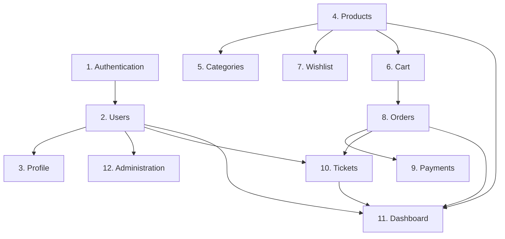

# Target Architecture Specification: DashStack Platform

> **Document Status**: Active Target Engineering Architecture & Migration Roadmap  
> **Target Scale**: Modular Monolith engineered to reliably serve ~1,000,000 active users  
> **Governance Alignment**: Compliant with [`.specify/memory/constitution.md`](file:///g:/react/next-go/Full-Stack-App-Store/.specify/memory/constitution.md) (v1.1.0) and baseline analysis in [`docs/current-architecture.md`](file:///g:/react/next-go/Full-Stack-App-Store/docs/current-architecture.md).

---

## 1. Executive Summary & Architectural Paradigm

The DashStack platform is transitioning from an early-stage prototype with tight coupling, mixed concerns, and unmounted security boundaries into a robust, maintainable, and scalable **Modular Monolith**. 

```
                                 ┌──────────────────────────────────────────────┐
                                 │                Browser Client                │
                                 └──────────────────────┬───────────────────────┘
                                                        │
                                                        ▼
                                 ┌──────────────────────────────────────────────┐
                                 │       Edge / Reverse Proxy (Nginx / ALB)     │
                                 └──────────────┬────────────────┬──────────────┘
                                                │                │
                        ┌───────────────────────┘                └────────────────────────┐
                        │ /                                                               │ /api/*
                        ▼                                                                 ▼
      ┌────────────────────────────────────┐                           ┌────────────────────────────────────┐
      │   Frontend: Next.js (Port 3000)    │                           │    Backend: Go + Fiber (Port 8000) │
      │  ┌──────────────────────────────┐  │                           │  ┌──────────────────────────────┐  │
      │  │ App Router (Pages & Layouts) │  │                           │  │ HTTP Transport (Fiber Handlers)│  │
      │  └──────────────┬───────────────┘  │                           │  └──────────────┬───────────────┘  │
      │                 ▼                  │                           │                 ▼                  │
      │  ┌──────────────────────────────┐  │                           │  ┌──────────────────────────────┐  │
      │  │ Features (Domain Boundaries) │  │                           │  │ Application / Use-Cases      │  │
      │  └──────────────┬───────────────┘  │                           │  └──────────────┬───────────────┘  │
      │                 ▼                  │                           │                 ▼                  │
      │  ┌──────────────┴───────────────┐  │                           │  ┌──────────────────────────────┐  │
      │  │ TanStack Query │ Redux Slice │  │                           │  │ Domain Core (Entities/Rules) │  │
      │  └──────────────┬───────────────┘  │                           │  └──────────────┬───────────────┘  │
      │                 ▼                  │                           │                 ▼                  │
      │  ┌──────────────────────────────┐  │                           │  ┌──────────────────────────────┐  │
      │  │ Central Axios API Client     ├──┼── HTTP (Bearer / Cookie) ─┼─►│ Repositories (SQLC Adapters) │  │
      │  └──────────────────────────────┘  │                           │  └──────────────┬───────────────┘  │
      └────────────────────────────────────┘                           └─────────────────┼──────────────────┘
                                                                                         │
                                                                   ┌─────────────────────┴──────────────────────┐
                                                                   │                                            │
                                                                   ▼                                            ▼
                                                    ┌──────────────────────────────┐             ┌──────────────────────────────┐
                                                    │ PostgreSQL 16 (Relational DB)│             │ Redis 7 (Cache / Ephemeral)  │
                                                    └──────────────────────────────┘             └──────────────────────────────┘
```

### Core Architectural Invariants
1. **Modular Monolith over Microservices**: Single deployable backend binary and single deployable frontend container. Boundaries are enforced through strict internal package and domain directory segregation.
2. **Correctness-First Scalability**: Scaling to 1,000,000 users is achieved via database correctness, optimal indexing, connection pooling, and selective caching—never by premature distributed systems complexity.
3. **Strict Layered Separation**: Handlers do not execute SQL queries; business logic lives exclusively in domain and use-case services.
4. **SQL-First Type Safety**: GORM is systematically replaced by native SQL compiled via [SQLC](https://sqlc.dev/) with version-controlled schema migrations.
5. **Separation of Server and Client State**: TanStack Query is the exclusive owner of remote server cache; Redux Toolkit is the exclusive owner of client-ephemeral state.

---

## 2. Target Backend Architecture

### 2.1 Layered Structure & Folder Layout
The backend adopts Clean/Hexagonal layered architecture within standard Go package conventions:

```
backend/
├── cmd/
│   └── api/
│       └── main.go                    # Bootstrap, DI wiring, graceful shutdown
├── internal/
│   ├── transport/
│   │   └── http/                      # HTTP/Transport Layer (Fiber)
│   │       ├── router.go              # Route registration & middleware chains
│   │       ├── middleware/            # Auth, RBAC, RateLimit, CORS, Logging, RequestID
│   │       ├── response/              # Standard JSON response & error envelopes
│   │       └── handler/               # Thin HTTP handlers grouped by domain
│   │           ├── auth_handler.go
│   │           ├── user_handler.go
│   │           ├── product_handler.go
│   │           ├── order_handler.go
│   │           └── ticket_handler.go
│   ├── application/                   # Application / Use-Case Layer
│   │   ├── dto/                       # Request/Response data transfer objects
│   │   └── service/                   # Business orchestration use-cases
│   │       ├── auth_service.go
│   │       ├── product_service.go
│   │       ├── order_service.go
│   │       └── ticket_service.go
│   ├── domain/                        # Pure Domain Layer
│   │   ├── entity/                    # Core business entities & domain models
│   │   ├── repository/                # Repository interface ports
│   │   └── errors.go                  # Domain-specific sentinel errors
│   └── infrastructure/                # Infrastructure & Adapters
│       ├── database/
│       │   ├── postgres.go            # pgxpool connection & tuning
│       │   ├── tx_manager.go          # Transaction coordinator
│       │   └── sqlc/                  # SQLC-generated type-safe Go code
│       │       ├── db.go
│       │       ├── models.go
│       │       ├── users.sql.go
│       │       └── products.sql.go
│       ├── cache/
│       │   └── redis.go               # Redis connection, key helpers, fallback
│       ├── storage/
│       │   └── s3.go                  # S3 object storage adapter
│       ├── background/
│       │   └── worker.go              # In-process or Redis-backed worker
│       └── config/
│           └── config.go              # 12-factor environment loader (envconfig/godotenv)
├── db/
│   ├── migrations/                    # Goose/Golang-Migrate SQL migration files
│   │   ├── 000001_init_schema.up.sql
│   │   └── 000001_init_schema.down.sql
│   └── queries/                       # Raw SQL queries for SQLC code generation
│       ├── users.sql
│       ├── products.sql
│       ├── orders.sql
│       └── tickets.sql
├── sqlc.yaml                          # SQLC compiler configuration
├── Dockerfile                         # Multi-stage production container
└── Makefile                           # Standard developer commands
```

### 2.2 Dependency Direction & Package Boundaries
Dependencies strictly flow **inward**:
$$\text{Transport (HTTP)} \longrightarrow \text{Application (Service)} \longrightarrow \text{Domain (Entities \& Repository Ports)} \longleftarrow \text{Infrastructure (SQLC)}$$

* **Domain** has zero dependencies on Fiber, GORM, SQLC, or third-party libraries.
* **Application** depends only on Domain.
* **Transport (Handlers)** depends only on Application Services.
* **Infrastructure** implements Domain repository interfaces using `pgx` and SQLC.

### 2.3 Data Access Layer: SQLC & Schema Migration Engine
* **SQLC Engine**: Replaces GORM. Queries are authored in pure SQL (`db/queries/*.sql`) with SQLC annotations (`-- name: GetProductByID :one`). SQLC compiles these into zero-allocation, type-safe Go structs and query functions.
* **Migration Tool**: [Goose](https://github.com/pressly/goose) or `golang-migrate` manages sequential SQL scripts in `db/migrations/`. 
* **Prohibition**: GORM `AutoMigrate` is permanently banned. All schema changes must be reversible (`.up.sql` and `.down.sql`).

### 2.4 Transaction Management (Unit of Work)
Multi-entity mutations (e.g. creating an Order, reserving Product stock, recording OrderItems) execute inside explicit transactions managed via an atomic transaction coordinator:
```go
type TransactionManager interface {
    WithTx(ctx context.Context, fn func(txRepo RepositoryRegistry) error) error
}
```
Use-case services invoke `txManager.WithTx` to encapsulate transactional logic without leaking SQL or DB connection handles into the service layer.

### 2.5 Validation & Input Sanitization
* **Request Validation**: Handlers bind payloads to Application DTOs and validate them using `go-playground/validator/v10` before invoking services.
* **Domain Validation**: Business invariants (e.g. "order total cannot be negative", "cannot transition ticket from Closed to Open without reason") are enforced inside Domain Entities.

### 2.6 Error Handling & Standard Error Envelopes
All API errors return a standardized JSON envelope:
```json
{
  "success": false,
  "error": {
    "code": "PRODUCT_OUT_OF_STOCK",
    "message": "The requested product variant is currently out of stock.",
    "details": { "product_id": 1042, "requested": 2, "available": 0 }
  },
  "request_id": "req-9a8b7c6d5e4f"
}
```
* Domain errors (e.g. `ErrNotFound`, `ErrUnauthorized`, `ErrConflict`) are mapped to HTTP status codes exclusively within the HTTP transport response layer.
* Internal errors log full stack traces and database details on the server, but return generic sanitized messages (`INTERNAL_SERVER_ERROR`) to the client.

### 2.7 Target Authentication & Multi-Session Architecture

The target architecture implements a zero-trust, multi-device authentication system combining short-lived Access JWTs with stateful, rotating, opaque Refresh Tokens backed by PostgreSQL.

#### 2.7.1 Dual-Token Specifications & Lifecycles

| Token Attribute | Access Token | Refresh Token |
| :--- | :--- | :--- |
| **Token Type** | Cryptographically signed JSON Web Token (JWT) | Cryptographically secure opaque random string |
| **Format** | Base64URL-encoded HMAC-SHA256 (or RS256) via `jwt/v5` | 32 bytes (256-bit entropy) generated by `crypto/rand` |
| **Lifetime (TTL)** | **15 Minutes** (Strictly short-lived) | **7 Days** (Sliding window on use, capped at 30 days max) |
| **Payload / Claims** | Standard minimal claims: `sub` (user_id), `role`, `jti`, `iss`, `aud`, `exp`, `iat`. No PII or passwords. | None (Opaque string without internal structure). |
| **Database Storage** | **Stateless** (Not persisted in database). | **Hash-Only**: Only one-way `SHA-256` hex digest is stored in PostgreSQL. Raw token is never stored. |
| **Rotation Policy** | Expired tokens are refreshed using valid refresh token. | **Rotated on Every Refresh**: Old token is revoked immediately; new opaque token is issued. |
| **Primary Purpose** | High-throughput stateless API authorization at middleware. | Long-term session persistence and token rotation. |

#### 2.7.2 Multi-Device & Session Model (`user_sessions` in PostgreSQL)
Every login on a distinct device or client creates an independent session record in PostgreSQL, which acts as the **sole authoritative Source of Truth (SSOT)**:

```sql
CREATE TABLE user_sessions (
    id UUID PRIMARY KEY DEFAULT gen_random_uuid(),
    user_id BIGINT NOT NULL REFERENCES users(id) ON DELETE CASCADE,
    refresh_token_hash VARCHAR(64) NOT NULL UNIQUE,
    device_identifier VARCHAR(128),
    device_platform VARCHAR(64) NOT NULL DEFAULT 'unknown',
    user_agent TEXT NOT NULL,
    ip_address VARCHAR(45) NOT NULL,
    created_at TIMESTAMPTZ NOT NULL DEFAULT NOW(),
    last_used_at TIMESTAMPTZ NOT NULL DEFAULT NOW(),
    expires_at TIMESTAMPTZ NOT NULL,
    revoked_at TIMESTAMPTZ DEFAULT NULL
);

CREATE INDEX idx_user_sessions_lookup ON user_sessions(refresh_token_hash) WHERE revoked_at IS NULL;
CREATE INDEX idx_user_sessions_user_active ON user_sessions(user_id) WHERE revoked_at IS NULL;
```

* **User Autonomy**: Users can view all active sessions (e.g. "Chrome on Windows", "Safari on iPhone"), identify their current session, revoke individual devices, or execute a global "Logout Everywhere" action.

#### 2.7.3 Refresh Flow & Token Reuse Detection (Replay Breach Mitigation)

```
[Client]                                  [Backend API]                             [PostgreSQL]
   │                                            │                                         │
   ├─ POST /api/v1/auth/refresh (Cookie) ──────>│                                         │
   │                                            ├─ SHA-256(refresh_token)                │
   │                                            ├─ Query session by hash ────────────────>│
   │                                            │<─ Session Record ───────────────────────┤
   │                                            │                                         │
   │                              [CASE 1: Normal Valid Refresh]                          │
   │                                            ├─ Verify: NOT revoked & NOT expired      │
   │                                            ├─ Generate new Access Token (15m)        │
   │                                            ├─ Generate new Opaque Refresh Token      │
   │                                            ├─ UPDATE session: new hash, new expiry ─>│
   │<─ Set-Cookie: access_token, refresh_token ─┤                                         │
   │                                            │                                         │
   │                             [CASE 2: Token Reuse / Theft Detected]                   │
   │                                            ├─ Token hash already revoked or missing! │
   │                                            ├─ REVOKE entire session / family ───────>│
   │                                            ├─ Log: SECURITY_ALERT: token_reuse       │
   │<─ HTTP 401 Unauthorized (Force Login) ─────┤                                         │
```

* **Breach Containment**: If a previously rotated or revoked refresh token is presented, the system treats it as an in-flight token theft / replay attack. The entire session is revoked immediately, an audit incident is recorded, and the client is forced to re-authenticate.

#### 2.7.4 Logout Semantics
* **Single Device Logout**: Revokes the specific active session (`UPDATE user_sessions SET revoked_at = NOW() WHERE id = $1`) and clears authentication cookies.
* **Global Logout ("Logout All Devices")**: Revokes all active sessions for the user (`UPDATE user_sessions SET revoked_at = NOW() WHERE user_id = $1 AND revoked_at IS NULL`).

#### 2.7.5 Decoupled Authorization & RBAC
* Authentication (verifying identity via JWT signature) is decoupled from Authorization (verifying resource rights).
* A valid JWT alone does not permit data access. Fiber middlewares enforce authorization:
  * `Authenticate`: Parses and validates JWT from cookie/header, populating `c.Locals("user_id")` and `c.Locals("role")`.
  * `RequireRole("admin")`: Enforces role-based permissions.
  * `VerifyOwnership`: Ensures authenticated `user_id` matches entity foreign key (e.g. orders, favorites).

#### 2.7.6 Web Security & Cookie Policies
* Refresh tokens are delivered via `HttpOnly`, `Secure`, `SameSite=Lax` cookies with path restricted to `/api/v1/auth/refresh`.
* Refresh tokens are **never** stored in browser `localStorage` or `sessionStorage`.
* CORS enforces explicit authorized origin white-listing (`Access-Control-Allow-Credentials: true`). Wildcard origins (`*`) are prohibited.

#### 2.7.7 Stateless Horizontal Scaling & Auditing
* Backend instances remain completely stateless; zero in-memory session cache is required for correctness.
* Redis is not the source of truth for sessions, ensuring strict ACID consistency in PostgreSQL.
* Passwords, raw tokens, and secret keys are automatically redacted from application logs.


### 2.8 Observability & Structured Logging
* **Structured Logger**: Standard library `log/slog` outputting machine-readable JSON logs to `stdout`.
* **Contextual Tracing**: A dedicated `RequestID` middleware generates or forwards `X-Request-ID` and injects it into every log line, database query, and outgoing HTTP request.
* **Sensitive Data Redaction**: Automatic filter masks passwords, tokens, cookies, and payment information.

### 2.9 Health Checks & Process Lifecycle
* `/health/live`: Returns `200 OK` if the Fiber HTTP process is running.
* `/health/ready`: Pings PostgreSQL (`db.Ping(ctx)`) and Redis (`redis.Ping(ctx)`). Returns `503 Service Unavailable` if core infrastructure is unreachable.
* **Graceful Shutdown**: On `SIGINT`/`SIGTERM`, the process triggers `app.ShutdownWithTimeout(30 * time.Second)`, drains in-flight requests, closes database pools, and flushes log buffers.

---

## 3. Redis Architectural Invariants & Use Cases

Redis is strictly an **ephemeral data store and high-throughput utility**, never a primary source of truth.

| Use Case | Redis Data Structure | Key Pattern & Namespace | TTL Policy | Failure / Fallback Behavior |
| :--- | :--- | :--- | :--- | :--- |
| **Catalog Read Cache** | String (JSON serialized) | `catalog:product:{id}`<br>`catalog:categories:tree` | Products: 1 hour<br>Categories: 24 hours | Cache Miss / Redis Down: Fetch from PostgreSQL, populate Redis asynchronously. Log warning; zero user downtime. |
| **Distributed Rate Limiting** | Sorted Set or String (Increment) | `ratelimit:{ip}:{endpoint}`<br>`ratelimit:auth:{email}` | 1 minute window (sliding) | Redis Down: Fail-open with local in-memory token bucket to prevent blocking legitimate users. |
| **Authentication Blacklist** | String (dummy value) | `auth:revoked:{jwt_jti}` | Matching remaining JWT expiration | Redis Down: Reject request or verify against PostgreSQL fallback audit table. |
| **Session / Temp Nonces** | String | `temp:password_reset:{token}`<br>`temp:otp:{user_id}` | 15 minutes | Redis Down: Return error to user to retry. |
| **Realtime Counters / Metrics** | Hash | `analytics:daily:{date}` | 7 days | Redis Down: Buffer in memory and write directly to DB aggregation table. |

### Caching Invariants:
1. **No Cache for Stale Writes**: All mutations (create/update/delete) invalidate relevant Redis keys immediately via event hooks or transaction commit hooks.
2. **Deterministic Fallback**: If Redis crashes, the application continues operating with degraded latency by querying PostgreSQL directly.
3. **No Query Hiding**: Caching must never be introduced to mask unindexed queries or architectural bottlenecks.

---

## 4. Target Frontend Architecture

### 4.1 Feature-Driven Directory Layout
The frontend transitions from ad-hoc page directories into a **Domain-Driven Modular Structure**:

```
frontend/
├── app/                               # Next.js App Router (Routing Shell Only)
│   ├── (auth)/
│   │   ├── login/page.tsx
│   │   └── signup/page.tsx
│   ├── (main)/
│   │   ├── layout.tsx                 # Public header, customer nav, footer
│   │   ├── page.tsx                   # Landing page
│   │   ├── products/
│   │   │   ├── page.tsx               # Catalog browse
│   │   │   └── [id]/page.tsx          # Customer Product Details (Previously 404!)
│   │   ├── cart/page.tsx
│   │   ├── wishlist/page.tsx
│   │   └── orders/page.tsx
│   ├── (dashboard)/
│   │   ├── layout.tsx                 # Protected admin shell & admin sidebar
│   │   └── admin/
│   │       ├── dashboard/page.tsx
│   │       ├── products/page.tsx
│   │       ├── orders/page.tsx
│   │       ├── users/page.tsx
│   │       └── tickets/page.tsx       # Independent Ticketing Management
│   ├── globals.css
│   └── layout.tsx                     # Universal providers (Theme, Redux, QueryClient)
├── features/                          # Feature Modules (Bounded Domains)
│   ├── auth/                          # Domain: Authentication
│   │   ├── components/                # LoginForm, SignupForm
│   │   ├── hooks/                     # useAuth, useSession
│   │   ├── api/                       # authApi.ts
│   │   └── types/                     # auth.types.ts
│   ├── products/                      # Domain: Products
│   │   ├── components/                # ProductCard, ProductGrid, ProductFilters
│   │   ├── hooks/                     # useProductsQuery, useProductDetailQuery
│   │   ├── api/                       # productApi.ts
│   │   └── types/                     # product.types.ts
│   ├── cart/                          # Domain: Shopping Cart
│   │   ├── components/                # CartDrawer, CartItemRow, CheckoutSummary
│   │   ├── slice/                     # cartSlice.ts (Redux Toolkit)
│   │   └── types/                     # cart.types.ts
│   ├── tickets/                       # Domain: Ticketing
│   │   ├── components/                # TicketList, TicketConversation, TicketReplyBox
│   │   ├── hooks/                     # useTicketsQuery, useTicketDetailQuery
│   │   ├── api/                       # ticketApi.ts
│   │   └── types/                     # ticket.types.ts
│   └── dashboard/                     # Domain: Admin Analytics
│       ├── components/                # KpiGrid, RevenueChart, OrderStatusPie
│       ├── api/                       # dashboardApi.ts
│       └── types/
├── components/
│   ├── ui/                            # Primitives (shadcn/Radix components)
│   └── shared/                        # App-wide components (Navbar, ThemeToggle, EmptyState)
├── lib/
│   ├── api/                           # Centralized Axios Client & Interceptors
│   │   ├── client.ts
│   │   └── error.ts
│   ├── query/                         # TanStack Query configuration & QueryClient
│   │   └── queryClient.ts
│   └── redux/                         # Redux Toolkit Store & Root Reducer
│       ├── store.ts
│       ├── hooks.ts
│       └── slices/                    # UI state, modals, filters
├── middleware.ts                      # Edge routing & JWT presence check
└── Dockerfile                         # Next.js multi-stage standalone build
```

### 4.2 Centralized API Client (`lib/api/client.ts`)
A single configured Axios instance handles all outbound HTTP requests:
* Sets `baseURL: process.env.NEXT_PUBLIC_API_URL || "http://localhost:8000/api"`.
* Injects `withCredentials: true` so HTTP-only session cookies pass automatically.
* Request interceptor attaches client metadata and `X-Request-ID`.
* Response interceptor normalizes errors into a uniform `ApiError` class:
  ```typescript
  export class ApiError extends Error {
    constructor(
      public code: string,
      message: string,
      public status: number,
      public details?: Record<string, unknown>
    ) {
      super(message);
    }
  }
  ```
* Seamlessly handles token refresh on `401 Unauthorized`.

### 4.3 Server State vs. Client State Architecture
```
┌────────────────────────────────────────────────────────────────────────────────────────┐
│                                   Application State                                    │
├───────────────────────────────────────────┬────────────────────────────────────────────┤
│         Server State (TanStack Query)     │       Client State (Redux Toolkit)         │
├───────────────────────────────────────────┼────────────────────────────────────────────┤
│ • Products & Categories catalog           │ • Shopping Cart items (offline-first)      │
│ • User Profiles & Permissions             │ • Active UI Filters & Sorting parameters   │
│ • Orders history & fulfillment details    │ • Modal & Drawer open/close toggles        │
│ • Support Tickets & Conversations         │ • Sidebar expanded/collapsed state         │
│ • Admin Dashboard KPIs & Charts           │ • Stepper / Multi-step Form active step    │
│ • Wishlist / Favorites list               │ • User client-only view preferences        │
└───────────────────────────────────────────┴────────────────────────────────────────────┘
```
**Strict Invariant**: Remote server data is never copied into Redux slices. TanStack Query manages caching, automatic refetching on window focus, background stale-while-revalidate, and pagination.

### 4.4 Resilient UI & 5-State Component Contract
Every asynchronous feature widget must handle 5 deterministic states:
1. **Idle**: Component ready.
2. **Loading**: Renders accessible skeleton placeholders matching exact layout dimensions.
3. **Error**: Displays localized error alert with a functional "Try Again" button invoking `query.refetch()`.
4. **Empty**: Displays semantic icon and action button (e.g. "No products found in this category — Clear Filters").
5. **Populated**: Renders complete data interface.

---

## 5. E-Commerce Domain Decompositions & Boundaries

The application is segregated into 12 core domains. Cross-domain communication is restricted to defined service interfaces or public API contracts:



### Domain Specifications
1. **Authentication Domain**:
   * *Responsibilities*: User registration, credential verification, JWT issuance, token revocation, password reset, session refresh.
   * *Dependencies*: Users.
2. **Users Domain**:
   * *Responsibilities*: User identity, account statuses (Active, Banned), role assignments, RBAC permission resolution.
   * *Dependencies*: None.
3. **Profile Domain**:
   * *Responsibilities*: Personal profile management, avatar uploads, delivery addresses, communication preferences.
   * *Dependencies*: Users.
4. **Products Domain**:
   * *Responsibilities*: Product catalog, SKU management, pricing, inventory stock level, variants (colors, attributes), media gallery.
   * *Dependencies*: Categories.
5. **Categories Domain**:
   * *Responsibilities*: Hierarchical category taxonomy (parent/children trees), slugs, category metadata.
   * *Dependencies*: None.
6. **Cart Domain**:
   * *Responsibilities*: Ephemeral & persistent cart items, quantity adjustments, line-item price calculation, stock reservation checks.
   * *Dependencies*: Products, Users.
7. **Wishlist Domain**:
   * *Responsibilities*: Customer saved items, toggle favorite, wishlist item count.
   * *Dependencies*: Products, Users.
8. **Orders Domain**:
   * *Responsibilities*: Order checkout, snapshot of product prices and titles, order status workflow (`Pending` -> `Paid` -> `Processing` -> `Shipped` -> `Delivered` -> `Cancelled`), customer order history, admin fulfillment.
   * *Dependencies*: Cart, Products, Users.
9. **Payments Domain**:
   * *Responsibilities*: Payment intent generation, gateway integration, webhook signature verification, idempotency token validation, refund tracking.
   * *Dependencies*: Orders.
10. **Tickets Domain**:
    * *Responsibilities*: Autonomous customer support threads, ticket status transitions (`Open`, `In-Progress`, `Resolved`, `Closed`), priority flags, attachments, internal agent notes.
    * *Dependencies*: Users, Orders (optional association).
11. **Dashboard Domain**:
    * *Responsibilities*: Read-only aggregation of business metrics, sales turnover, customer acquisition trends, operational KPIs.
    * *Dependencies*: Orders, Products, Users, Tickets (read-only analytical queries).
12. **Administration Domain**:
    * *Responsibilities*: System-wide configuration, role/permission matrices, user ban/unban, audit logs.
    * *Dependencies*: All domains.

---

## 6. Bounded Domain Deep-Dives

### 6.1 Ticketing Subsystem (Autonomous Bounded Context)
The Ticketing system is decoupled from generic e-commerce pages and functions as a full customer-support hub:
* **Data Lifecycle**:
  ```
  [Customer Submits] -> OPEN -> [Agent Assigned] -> IN_PROGRESS -> [Resolved] -> RESOLVED -> CLOSED
                           │                               │
                           └───► [Pending Customer] ◄──────┘
  ```
* **Core Capabilities**:
  * Full-text search across ticket subjects and message bodies.
  * Faceted filtering by status, priority (`Low`, `Medium`, `High`, `Urgent`), assignee, and date range.
  * Chronological conversational thread with separation between public customer messages and internal staff notes (`is_internal: true`).
  * File attachment handling backed by S3 with presigned upload URLs.
* **UI Workflow (Gmail-Inspired, Clean Separation)**:
  * Master-detail two-pane layout: Left pane displays list/filters with unread indicators; right pane displays conversation timeline and interactive reply box.
  * Pure UI presentation: UI state (selected ticket ID, active folder tab) lives in Redux/URL query params; ticket data is fetched cleanly via TanStack Query. Zero hardcoded mock emails.

### 6.2 Landing Page Architecture
The public landing page is built for high conversion, accessibility, and dynamic content injection:
* **Section Hierarchy**:
  1. **Hero Banner Carousel**: Promotional campaigns with responsive images and action buttons.
  2. **Top Categories Carousel**: Circular badge row with category icons and direct catalog links.
  3. **New Arrivals Row**: Horizontal scrollable product row with smooth snapping and scroll indicators.
  4. **Best Sellers Row**: Curated high-volume products.
  5. **Flash Deals / Big Discounts**: Products filtered by discount percentage with countdown timers.
  6. **Promotional Value Blocks**: Free shipping, warranty, secure payment assurance badges.
* **Component Specification**:
  * Product rows use CSS scroll snap (`scroll-snap-type: x mandatory`) and arrow navigation controls.
  * Renders 5 visual states independently for each row (one failed section does not crash the landing page).

### 6.3 Operational Admin Dashboard
Replaces decorative charts and hardcoded mock data with actionable operational metrics:
* **KPI Metric Cards (Top Row)**:
  * **Total Revenue**: Aggregate sum of completed orders with percentage comparison to prior period.
  * **Total Orders**: Count of orders segmented by fulfillment status.
  * **Active Users**: Verified active customer accounts.
  * **Pending Support Tickets**: Count of tickets requiring response (< SLA).
* **Analytical Visualization Components**:
  * **Main Trend Chart (Area / Bar)**: Daily/Weekly Revenue & Order volume trends over selectable time ranges (7d, 30d, 90d).
  * **Orders by Status (Donut Chart)**: Distribution of pending, processing, shipped, and cancelled orders.
  * **Category Share (Pie Chart)**: Sales contribution percentage by category.
  * **Ticket Resolution Velocity (Line Chart)**: Average resolution time trend.
* **User Operational Panel**:
  * Quick table of recently registered users, displaying avatar, name, verification status, and role management actions.

---

## 7. Target Infrastructure & Operations

### 7.1 Production-Grade Docker Containers
* **Backend Dockerfile (Multi-Stage Go)**:
  1. *Build Stage*: `golang:1.25-alpine`, caches Go modules, compiles static binary with `CGO_ENABLED=0 -ldflags="-w -s"`.
  2. *Runtime Stage*: Minimal `alpine:3.20` or Google Distroless, runs as non-root user `appuser (UID 10001)`, exposes port `8000`. Image size: < 25 MB.
* **Frontend Dockerfile (Multi-Stage Next.js Standalone)**:
  1. *Dependencies Stage*: `node:20-alpine`, installs production dependencies via `pnpm`.
  2. *Build Stage*: Runs `pnpm build` with `output: "standalone"` enabled in `next.config.ts`.
  3. *Runtime Stage*: Minimal Alpine node runner executing `node server.js` as non-root user `nextjs (UID 1001)`. Image size: < 150 MB.

### 7.2 Docker Compose Local Environment (`docker-compose.yml`)
Standardized local orchestration providing identical parity with staging/production:
* `postgres`: PostgreSQL 16 Alpine, persistent volume, healthcheck via `pg_isready`.
* `redis`: Redis 7 Alpine with persistent append-only storage (`appendonly yes`).
* `backend`: Go Fiber service mounted with live hot-reload (`air`) during development.
* `frontend`: Next.js service mounting workspace code.
* `minio` (Optional Local S3): Emulates ParsPack S3 storage for offline testing.

### 7.3 Standardized Makefile Commands
Root `Makefile` eliminating tribal knowledge and manual scripting:
```makefile
.PHONY: dev test lint build migrate migration docker-up docker-down ci

dev: docker-up
	@echo "Starting local dev environments..."

test:
	cd backend && go test -v -race ./...
	cd frontend && pnpm test

lint:
	cd backend && golangci-lint run
	cd frontend && pnpm lint && pnpm typecheck

format:
	cd backend && gofmt -w .
	cd frontend && pnpm format

build:
	cd backend && CGO_ENABLED=0 go build -o bin/api cmd/api/main.go
	cd frontend && pnpm build

migrate:
	goose -dir db/migrations postgres "$$DATABASE_URL" up

migration:
	goose -dir db/migrations create $(name) sql

docker-up:
	docker compose up -d postgres redis

docker-down:
	docker compose down

ci: lint test build
```

### 7.4 Continuous Integration & Delivery (GitHub Actions)
A single fail-fast pipeline on all Pull Requests and merges:
```
[PR Trigger] ──► [Job 1: Backend Lint & Typecheck] ──► [Job 3: Backend Tests] ──► [Job 5: Docker Build]
             └──► [Job 2: Frontend Lint & Types]    ──► [Job 4: Frontend Tests]  ──► [Job 6: Security Scan]
```
* **Security Scans**: Executes `govulncheck` on Go code, `pnpm audit` on npm dependencies, and `gitleaks` to block committed credentials.
* **Automated Deployments**: Tagged releases automatically build container images, push to container registry, and execute database migrations before shifting live traffic.

---

## 8. Comprehensive Migration Strategy (Non-Destructive Evolution)

The modernization follows the **Strangler Fig Pattern**, incrementally replacing flawed code with zero downtime and zero blind rewrites.

### 8.1 Action Categorization

```
┌─────────────────────────────────────────────────────────────────────────────────────────────────────────┐
│                                       Codebase Action Classification                                    │
├───────────────────┬───────────────────┬─────────────────────┬───────────────────┬───────────────────────┤
│    KEEP (حفظ)     │  REFACTOR (اصلاح) │    MIGRATE (مهاجرت) │    DELETE (حذف)   │ BUILD FROM SCRATCH    │
├───────────────────┼───────────────────┼─────────────────────┼───────────────────┼───────────────────────┤
│ • Fiber router    │ • Auth Controller │ • GORM Models       │ • Committed .exe  │ • SQLC queries & code │
│   framework       │   (split logic    │   to SQLC schemas   │   binary in tmp/  │ • Goose SQL migration │
│ • PostgreSQL db   │   into services)  │ • Next.js rewrites  │ • Broken auth.ts  │   files               │
│ • Tailwind CSS v4 │ • Layout hierarchy│   to Central Axios  │   (Prisma mock)   │ • Central Axios client│
│   design tokens   │   (remove double  │ • S3 upload flow    │ • Inactive        │ • TanStack Query      │
│ • shadcn UI       │   sidebars)       │   (consolidate to   │   proxy.ts file   │   custom hooks        │
│   primitive base  │ • Zod validation  │   backend action)   │ • 43 unused UI    │ • Redux Toolkit cart  │
│ • S3 client       │   schemas in forms│ • Client useEffect  │   primitives      │   & UI slices         │
│   credentials     │ • Route names     │   fetching to       │ • 3x duplicated   │ • Customer Product    │
│                   │   (unify plural   │   TanStack Query    │   banner copies   │   Detail page ([id])  │
│                   │   vs singular)    │                     │ • Mock chart data │ • Automated test suite│
│                   │                   │                     │   components      │ • Makefile & CI/CD    │
└───────────────────┴───────────────────┴─────────────────────┴───────────────────┴───────────────────────┘
```

### 8.2 Subsystem Migration Roadmap & Matrix

| Subsystem | Current Codebase State | Target Structure | Migration Strategy | Dependencies | Risk | Priority |
| :--- | :--- | :--- | :--- | :--- | :--- | :--- |
| **Database Connection & Schemas** | Undeclared `dsn` compilation bug; GORM AutoMigrate on startup. | Pure SQL schemas managed by Goose; SQLC for query generation. | 1. Fix `dsn` typo immediately.<br>2. Dump current schema to `000001_init.sql`.<br>3. Introduce Goose & SQLC.<br>4. Generate models feature-by-feature. | PostgreSQL | High (Build Blocking) | **P0 (Immediate)** |
| **Backend Route Security** | Unmounted middlewares; open routes allowing unauthenticated data deletion. | Route groups guarded by JWT authentication & RBAC middleware. | 1. Group routes (`/api/v1/auth`, `/api/v1/store`, `/api/v1/admin`).<br>2. Mount `IsAuthenticated` on user & order routes.<br>3. Mount `IsAuthorized` on admin routes. | Fiber Router | High (Vulnerability) | **P0 (Immediate)** |
| **Configuration & Secrets** | Hardcoded secrets (`"secret"` JWT key, hardcoded ports and DB passwords). | 12-factor configuration reading from `.env` via `config.go`. | 1. Implement `internal/config/config.go`.<br>2. Create `.env.example`.<br>3. Replace all hardcoded strings with config references. | None | Medium | **P1 (High)** |
| **Frontend Layout & Navigation** | Double nested `<SidebarProvider>` and `<AppSidebar>` rendering duplicate DOM. | Single root sidebar shell with context-aware menu items. | 1. Remove duplicate sidebar from `(main)/layout.tsx`.<br>2. Standardize `AppSidebar` and `SidebarDash`.<br>3. Fix missing customer route `/products/[id]`. | React / Next.js | Medium (UX Glitch) | **P1 (High)** |
| **Frontend HTTP Client** | Fragmented calls: some via Next rewrites, some direct to `:8000` via Axios. | Centralized Axios client in `lib/api/client.ts` with error interceptors. | 1. Implement central client.<br>2. Migrate Server Actions and Client Components to use central client.<br>3. Remove Next.js rewrite proxy. | Axios | Medium | **P1 (High)** |
| **State Management** | Ad-hoc `useEffect` queries, state duplicating server responses, no cache. | TanStack Query for all server state; Redux Toolkit for cart & UI. | 1. Install `@tanstack/react-query` & `@reduxjs/toolkit`.<br>2. Wrap app in `QueryClientProvider` & `Provider`.<br>3. Migrate queries domain by domain. | Query / Redux | Medium | **P2 (Medium)** |
| **Dead Code Elimination** | Unregistered category/permission controllers, dead models, broken Prisma auth. | Clean codebase free of dead files, orphans, and committed binaries. | 1. Verify zero references with tests.<br>2. Remove `backend/tmp/main.exe`.<br>3. Remove `frontend/lib/auth.ts` and `proxy.ts`.<br>4. Prune unused UI components. | Git | Low | **P2 (Medium)** |
| **Container & CI/CD** | No Docker, no Makefile, no automated testing pipelines. | Multi-stage Dockerfiles, Docker Compose, Makefile, and GitHub Actions. | 1. Author Dockerfiles & Compose.<br>2. Create root Makefile.<br>3. Configure GitHub Actions CI workflow. | Docker / GitHub | Low | **P2 (Medium)** |
| **Redis Caching & Rate Limiting** | Zero caching; no rate limiting on sensitive login/register routes. | Redis token bucket rate limiting and catalog response caching. | 1. Spin up Redis in Compose.<br>2. Add rate-limit middleware to auth.<br>3. Cache category tree and product details. | Redis | Medium | **P3 (Post-Migration)** |
| **Ticketing Subsystem** | Incomplete mockup with dummy strings (`"aa"`, `"..."`) and static mock data. | Autonomous ticket domain with real DB entities, conversation threads, and UI. | 1. Implement SQLC ticket queries.<br>2. Build TicketService use-cases.<br>3. Build master-detail two-pane UI connected to TanStack Query. | SQLC / S3 | Medium | **P3 (Feature Complete)** |

### 8.3 Phased Execution Schedule
* **Phase 0: Build Integrity & Baseline Stability (Sprint 1)**
  * Resolve database compilation bug in `conected.go`.
  * Secure open backend routes with JWT and RBAC middlewares.
  * Move secrets and connection strings to `.env`.
  * Eliminate duplicate layout sidebars and dead code binaries (`backend/tmp/main.exe`).
* **Phase 1: Toolchain & Infrastructure Foundation (Sprint 2)**
  * Establish Docker, Docker Compose, root Makefile, and GitHub Actions CI.
  * Install and configure Goose migration engine and SQLC compiler.
  * Set up centralized frontend Axios client and TanStack Query / Redux providers.
* **Phase 2: Core Domain Modernization (Sprint 3 - 4)**
  * Migrate Auth, Users, and Roles to SQLC repositories and clean services.
  * Migrate Products and Categories to SQLC and TanStack Query.
  * Implement customer product detail page `/products/[id]`.
* **Phase 3: E-Commerce & Transaction Lifecycle (Sprint 5 - 6)**
  * Implement Cart (Redux) and Checkout workflow with transaction manager.
  * Modernize Orders and Payments with webhook idempotency.
  * Integrate Redis caching for catalog data and distributed rate limiting.
* **Phase 4: Support, Analytics & Hardening (Sprint 7 - 8)**
  * Build autonomous Ticketing subsystem.
  * Connect operational Dashboard to real aggregated SQLC queries.
  * Execute performance profiling, indexing validation, and full load tests for 1,000,000 user readiness.

---

## 9. Architecture Gaps (Current Reality vs. Target State)

This gap analysis establishes the precise technical distance between the existing repository state (documented in [`docs/current-architecture.md`](file:///g:/react/next-go/Full-Stack-App-Store/docs/current-architecture.md)) and this Target Architecture:

| Evaluation Dimension | Current State Reality (As of Today) | Target Architectural State | Remediation Action Required |
| :--- | :--- | :--- | :--- |
| **Build Stability** | Backend fails compilation due to undeclared variable `dsn` in [`conected.go:17`](file:///g:/react/next-go/Full-Stack-App-Store/backend/databases/conected.go#L17). | Clean compilation with zero compiler or linter errors. | Fix typo (`dns` -> `dsn`) in database initialization. |
| **Backend Layering** | Direct database coupling: Controllers execute GORM queries directly; business logic is embedded in handlers. | 5-tier clean separation (HTTP -> Application Service -> Domain -> Repository Port -> SQLC Adapter). | Extract domain services and repository interfaces; decouple Fiber handlers from SQL execution. |
| **Data Access & Schemas** | GORM ORM with GORM AutoMigrate; broken preload association `.Preload("OrderItems")` vs struct `OrderItem`. | SQL-first type-safe queries generated by SQLC; versioned SQL schema migrations managed by Goose. | Replace GORM with SQLC; dump schema to versioned SQL files; eliminate runtime ORM reflection bugs. |
| **Backend Security** | Open API endpoints: Middlewares [`authMiddleware`](file:///g:/react/next-go/Full-Stack-App-Store/backend/middlewares/authMiddleware.go) and [`permissionMiddleware`](file:///g:/react/next-go/Full-Stack-App-Store/backend/middlewares/permissionMiddleware.go) are never mounted in [`routes.go`](file:///g:/react/next-go/Full-Stack-App-Store/backend/routes/routes.go). IDOR vulnerability in Favorites controller. | Defense-in-depth: Route groups protected by JWT validation and RBAC permission checks at the middleware layer. | Mount authentication and permission middlewares to all protected Fiber route groups; extract user identity from JWT context. |
| **Secrets & Config** | Hardcoded secrets: JWT secret key `"secret"`, database credentials, and port numbers hardcoded in source code. | 12-factor configuration: All secrets and settings injected dynamically via environment variables. | Create `config.go` and `.env.example`; resolve all dynamic configuration from environment variables. |
| **Frontend State** | Fragmented state: Mix of raw `useEffect` fetching, Server Actions, and uncoordinated state without caching. | Strict separation: TanStack Query manages 100% of server state; Redux Toolkit manages client/UI state. | Install and configure `@tanstack/react-query` and `@reduxjs/toolkit`; migrate domain data to query hooks. |
| **Frontend Transport** | Dual transport pathways: Client components call `:3000/api/*` via Next rewrites, while Server Actions call `:8000` directly. | Single centralized Axios client with standard interceptors, baseURL configuration, and normalized error envelopes. | Implement `lib/api/client.ts`; route all requests through central client; remove Next.js rewrite proxy. |
| **Routing & Layout** | Duplicate nested `<SidebarProvider>` and `<AppSidebar>` rendering duplicate DOM trees; missing storefront `/products/[id]` route (404); misnamed `proxy.ts`. | Unified single sidebar layout hierarchy; functional customer product detail route; active `middleware.ts`. | Remove duplicate sidebar from `(main)/layout.tsx`; build customer product detail page; rename `proxy.ts` to `middleware.ts`. |
| **Dead & Legacy Code** | Unregistered category/permission controllers; orphaned `Message` & `Label` models; broken `lib/auth.ts` (Prisma); 43 unused UI components; 24MB Windows `.exe` committed in `tmp/`. | Lean, auditable codebase with zero orphaned files, zero dead controllers, and no binary artifacts in version control. | Delete `backend/tmp/main.exe`, `lib/auth.ts`, `proxy.ts`, unused shadcn components, and redundant duplicate banner components. |
| **Automated Testing** | Zero automated tests: 0 Go test files, 0 frontend test files, no test runner or npm test scripts configured. | Comprehensive test pyramid: Go unit and repository tests (`testify`), frontend component tests, and API contract verification. | Introduce Go test suites and Vitest/RTL frontend tests; mandate testing gates in CI. |
| **Container & CI/CD** | No Dockerfiles, no Docker Compose, no Makefile, no GitHub Actions workflows. | Fully automated developer workflows (`Makefile`), reproducible Compose environments, and fail-fast GitHub Actions CI/CD. | Author multi-stage Dockerfiles, `docker-compose.yml`, root `Makefile`, and `.github/workflows/ci.yml`. |
| **Caching & Reliability** | No Redis infrastructure; no rate limiting on authentication; no health/readiness probe endpoints; ungraceful shutdown. | Redis-backed read caching, distributed rate limiting, standard `/health/live` & `/health/ready` probes, and graceful shutdown. | Provision Redis; add rate limiting middleware; implement liveness/readiness probes and OS signal draining. |
| **Ticketing Subsystem** | Incomplete UI mockup displaying static dummy text (`"aa"`, `"aaa"`, `"..."`) and hardcoded mock data arrays; no backend endpoints. | Autonomous core domain featuring conversation threads, faceted search/filtering, agent assignment, and S3 attachments. | Implement backend SQLC ticket schema and API; build functional two-pane responsive master-detail ticketing UI. |
| **Dashboard Intelligence** | Dashboard consists of static mock data charts; 6 chart components unrendered; no live operational analytics. | Real-time operational dashboard visualizing live revenue, order fulfillment, user growth, and support SLA performance. | Connect dashboard KPI cards and charts to aggregated backend analytical queries; prune dead chart components. |
