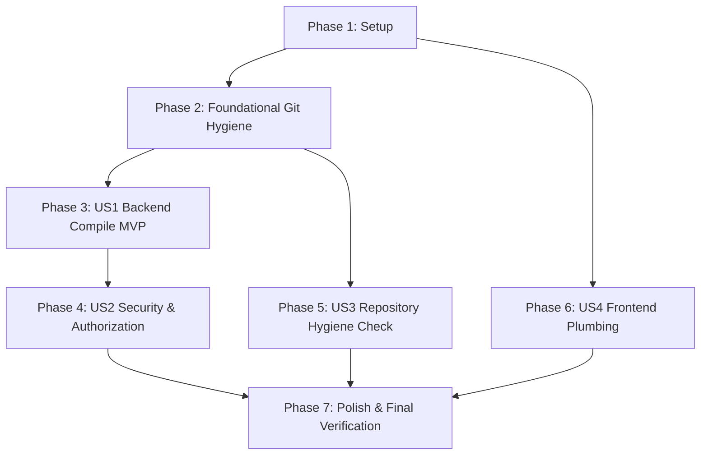

# Implementation Tasks: Phase 0 — Triage, Compilation Integrity & Perimeter Security Hygiene

**Feature**: [Phase 0 Specification](spec.md) | [Implementation Plan](plan.md)  
**Branch**: `001-phase0-triage-hygiene`  
**Date**: 2026-09-15  
**Status**: Ready for Execution  

---

## Phase 1: Setup (Shared Infrastructure & Environment Baseline)

**Purpose**: Establish configuration templates and ensure frontend dependencies are locked and ready.

- [X] T001 Record baseline environment snapshot (Go, Node, pnpm versions, git status) in `specs/001-phase0-triage-hygiene/quickstart.md`
- [X] T002 [P] Create template configuration `backend/.env.example` documenting PORT, DB_HOST, DB_PORT, DB_USER, DB_PASSWORD, DB_NAME, DB_SSLMODE, and JWT_SECRET
- [X] T003 [P] Create template configuration `frontend/.env.example` documenting NEXT_PUBLIC_API_URL, PARSPACK_ENDPOINT, PARSPACK_ACCESS_KEY, PARSPACK_SECRET_KEY, and PARSPACK_BUCKET_NAME
- [X] T004 Install frontend dependencies with frozen lockfile via `pnpm install --frozen-lockfile` in `frontend/` (document any network/registry error as environment blocker)

---

## Phase 2: Foundational (Repository Hygiene & Tracking Cleanup)

**Purpose**: Core cleanup and version control protection that MUST be complete before code modifications begin.

- [X] T005 [P] Create root `.gitignore` ignoring OS files, build artifacts, and `.env*` while preserving `.env.example` via `!.env.example` in [`.gitignore`](file:///g:/react/next-go/Full-Stack-App-Store/.gitignore)
- [X] T006 [P] Create backend `.gitignore` ignoring `/tmp/`, `/uploads/*`, `!/uploads/.gitkeep`, `*.exe`, `*.test`, `*.out` in [`backend/.gitignore`](file:///g:/react/next-go/Full-Stack-App-Store/backend/.gitignore)
- [X] T007 Untrack and physically remove compiled Windows binary via `git rm -f backend/tmp/main.exe`
- [X] T008 Untrack developer runtime test PNG uploads from Git index via `git rm --cached backend/uploads/*.png` (retaining local files)

---

## Phase 3: User Story 1 - Backend Compilation Integrity & 12-Factor Configuration (Priority: P1) 🎯 MVP

**Goal**: Restore backend compilation to a 100% passing state and establish environment-driven configuration for local and containerized execution.

**Independent Test**: Execute `cd backend && go build ./...`. Command terminates with exit code `0` and 0 diagnostic errors.

### Implementation for User Story 1
- [X] T009 [US1] Fix variable declaration typo from `dns` to `dsn` in [`backend/databases/conected.go`](file:///g:/react/next-go/Full-Stack-App-Store/backend/databases/conected.go)
- [X] T010 [US1] Implement helper `getEnv(key, defaultVal string) string` and construct connection DSN from `DB_HOST`, `DB_PORT`, `DB_USER`, `DB_PASSWORD`, `DB_NAME`, `DB_SSLMODE` with local fallbacks in [`backend/databases/conected.go`](file:///g:/react/next-go/Full-Stack-App-Store/backend/databases/conected.go)
- [X] T011 [US1] Add dependency `github.com/joho/godotenv` to [`backend/go.mod`](file:///g:/react/next-go/Full-Stack-App-Store/backend/go.mod) via `go get github.com/joho/godotenv`
- [X] T012 [US1] Load `.env` in development and dynamically bind server listening port from `PORT` (fallback `"8000"`) in [`backend/main.go`](file:///g:/react/next-go/Full-Stack-App-Store/backend/main.go)
- [X] T013 [US1] Externalize hardcoded JWT secret constant to dynamic `getJwtSecret() []byte` reading `JWT_SECRET` with dev fallback in [`backend/util/jwt.go`](file:///g:/react/next-go/Full-Stack-App-Store/backend/util/jwt.go)
- [X] T014 [US1] Verify clean Go backend compilation via `cd backend && go build ./...`

**Checkpoint**: At this point, User Story 1 is complete. Backend builds cleanly and reads configuration dynamically.

---

## Phase 4: User Story 2 - Security Perimeter & Critical Mutation Authorization (Priority: P1)

**Goal**: Secure all destructive, administrative mutation, and personal endpoints against anonymous attackers, non-admin privilege escalation, and cross-user IDOR tampering.

**Independent Test**: Run `cd backend && go test ./...`. In-memory automated test suite passes, verifying HTTP 401 on unauthenticated calls, HTTP 403 on non-admin mutations, HTTP 403 on favorite IDOR, and HTTP 200 on public catalog.

### Tests for User Story 2 (TDD Verification)
- [X] T015 [P] [US2] Write in-memory automated Fiber test suite verifying 401 unauthenticated, 403 unauthorized, and 200 public catalog responses in [`backend/routes/routes_test.go`](file:///g:/react/next-go/Full-Stack-App-Store/backend/routes/routes_test.go)

### Implementation for User Story 2
- [X] T016 [US2] Implement temporary `RequireAdmin` middleware checking `RoleID == 2` (or `Role.Name == "admin"`) returning 403 on non-admin in [`backend/middlewares/authMiddleware.go`](file:///g:/react/next-go/Full-Stack-App-Store/backend/middlewares/authMiddleware.go)
- [X] T017 [US2] Implement favorite resource ownership check ensuring `input.UserID == caller.ID` returning 403 on IDOR mismatch in [`backend/controllers/favoriteController.go`](file:///g:/react/next-go/Full-Stack-App-Store/backend/controllers/favoriteController.go)
- [X] T018 [US2] Mount `IsAuthenticated` and `RequireAdmin` guards on admin routes (`DELETE/POST/PUT /api/users`, `GET /api/users`, `GET /api/alluser`, `GET /api/users/:id`, `DELETE/POST/PUT /api/products/:id`, `POST /uploads`, `GET/POST/PUT/DELETE /api/roles`, `GET /api/orders`, `GET /api/orders/export`, `GET /api/orders/chart`) in [`backend/routes/routes.go`](file:///g:/react/next-go/Full-Stack-App-Store/backend/routes/routes.go)
- [X] T019 [US2] Mount `IsAuthenticated` on personal profile and favorite routes (`GET /api/user`, `PUT /api/updateinfo`, `PUT /api/updatepassword`, `GET/POST/DELETE /api/favorites`) in [`backend/routes/routes.go`](file:///g:/react/next-go/Full-Stack-App-Store/backend/routes/routes.go)
- [X] T020 [US2] Run automated test suite via `cd backend && go test ./...` to verify all security boundary assertions pass

**Checkpoint**: At this point, User Stories 1 AND 2 are complete and verified. Security perimeter is closed.

---

## Phase 5: User Story 3 - Repository Hygiene Verification & Secret Rotation Audit (Priority: P1)

**Goal**: Ensure no binaries or developer test artifacts linger in Git tracking, and document credential exposure for future deployment rotation.

**Independent Test**: `git ls-files backend/tmp` and `git ls-files backend/uploads` return zero lines. `git check-ignore` validates `.env` protection while `.env.example` remains tracked.

### Implementation for User Story 3
- [X] T021 [US3] Verify zero compiled binaries or upload images are tracked in Git via `git ls-files backend/tmp` and `git ls-files backend/uploads`
- [X] T022 [US3] Verify `.gitignore` rules correctly ignore local `.env` while preserving `.env.example` via `git check-ignore`
- [X] T023 [US3] Document historical leaked credentials (`password=13802002`) and formulate mandatory production secret rotation requirements in `specs/001-phase0-triage-hygiene/research.md`

**Checkpoint**: Repository is clean of binary debris and uncommitted test artifacts.

---

## Phase 6: User Story 4 - Frontend Plumbing, Route Protection & Server Action Contract (Priority: P2)

**Goal**: Eliminate duplicate storefront sidebar, activate Next.js 16 edge route protection, and forward session credentials in admin Server Actions to prevent regression in user management.

**Independent Test**: Storefront renders 1 `<aside>` element; direct browser navigation to `/dashboard` redirects to `/login`; `deleteUser` Server Action passes `Cookie: jwt=${token}` to backend.

### Implementation for User Story 4
- [X] T024 [P] [US4] Remove `<SidebarProvider>` and `<AppSidebar />` wrapper from root layout, retaining `<ThemeProvider>` and `<Toaster />` in [`frontend/app/layout.tsx`](file:///g:/react/next-go/Full-Stack-App-Store/frontend/app/layout.tsx)
- [X] T025 [P] [US4] Rename `frontend/proxy.ts` to `frontend/middleware.ts` and update export signature to `export function middleware(request: NextRequest)` in [`frontend/middleware.ts`](file:///g:/react/next-go/Full-Stack-App-Store/frontend/middleware.ts)
- [X] T026 [US4] Forward caller session cookie `Cookie: jwt=${token}` via `getToken()` in `deleteUser` Server Action to prevent dashboard regression in [`frontend/app/actions/user.action.ts`](file:///g:/react/next-go/Full-Stack-App-Store/frontend/app/actions/user.action.ts)
- [X] T027 [US4] Forward caller session cookie in `removeFromFavorites` and `addToFavorites` in [`frontend/app/actions/favorite.ts`](file:///g:/react/next-go/Full-Stack-App-Store/frontend/app/actions/favorite.ts)
- [X] T028 [US4] Execute frontend static typecheck via `cd frontend && pnpm exec tsc --noEmit`
- [X] T029 [US4] Execute frontend production build validation via `cd frontend && pnpm build`

**Checkpoint**: Frontend layout, route protection, and admin Server Actions are fully functional without regressions.

---

## Phase 7: Polish & Cross-Cutting Verification

**Purpose**: Final repository-wide verification gates ensuring clean formatting, zero regressions, and DoD compliance.

- [X] T030 Execute full backend code formatting check via `cd backend && gofmt -l .`
- [X] T031 Run end-to-end sanity verification matching `quickstart.md` commands across backend and frontend
- [X] T032 Verify clean git status with zero untracked artifacts via `git status`

---

## Dependencies & Execution Order

### Phase Dependencies

- **Setup (Phase 1)**: Can start immediately.
- **Foundational (Phase 2)**: Depends on Phase 1 completion (prerequisite for clean git tracking and environment baselines).
- **User Story 1 (Phase 3)**: Depends on Phase 1 & 2. Delivers compilability MVP.
- **User Story 2 (Phase 4)**: Depends on User Story 1 (requires compiling backend and `godotenv`).
- **User Story 3 (Phase 5)**: Depends on Phase 2 (validates hygiene and artifact untracking).
- **User Story 4 (Phase 6)**: Can proceed in parallel with Phase 3/4 after Phase 1 (`pnpm install`).
- **Polish (Phase 7)**: Depends on all User Stories being complete.



### User Story Dependencies

- **User Story 1 (P1)**: Independent of other stories; requires Foundational.
- **User Story 2 (P1)**: Depends on US1 (compiling backend & env resolution).
- **User Story 3 (P1)**: Verifies Foundational cleanup.
- **User Story 4 (P2)**: Independent frontend stream; can proceed once `pnpm install` completes.

---

## Parallel Opportunities

```bash
# Parallel Stream 1: Configuration Templates
Task: "T002 [P] Create template configuration backend/.env.example"
Task: "T003 [P] Create template configuration frontend/.env.example"

# Parallel Stream 2: Git Hygiene Rules
Task: "T005 [P] Create root .gitignore"
Task: "T006 [P] Create backend .gitignore"

# Parallel Stream 3: Frontend Layout & Middleware
Task: "T024 [P] [US4] Remove duplicate sidebar in frontend/app/layout.tsx"
Task: "T025 [P] [US4] Rename proxy.ts to middleware.ts in frontend/middleware.ts"
```

---

## Implementation Strategy

### MVP First (User Story 1 Only)
1. Complete Phase 1 (Setup) and Phase 2 (Foundational).
2. Complete Phase 3 (User Story 1).
3. **VALIDATE**: Run `cd backend && go build ./...` $\rightarrow$ Exit code 0.
4. **MVP Milestone Achieved**: Backend compiles cleanly from fresh checkout.

### Incremental Delivery Sequence
1. **Increment 1 (MVP)**: Compilation restored + environment variables (`conected.go`, `godotenv`).
2. **Increment 2 (Perimeter Security)**: Guards mounted on all mutations + IDOR prevention + Server Action cookie forwarding (`routes.go`, `user.action.ts`).
3. **Increment 3 (Hygiene)**: `main.exe` and test uploads removed from Git; `.gitignore` active.
4. **Increment 4 (Frontend)**: Double sidebar eliminated; canonical `middleware.ts` protecting routes.
5. **Increment 5 (DoD Gate)**: In-memory Fiber tests pass; `pnpm build` succeeds; clean git status.
